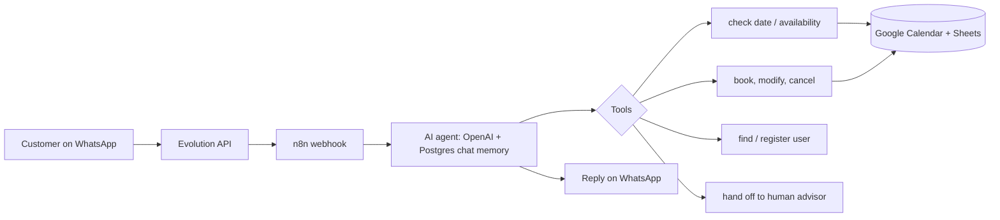
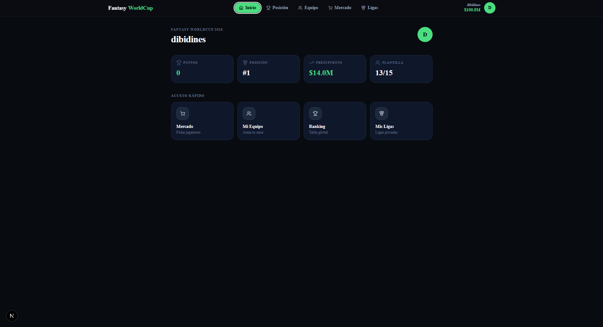
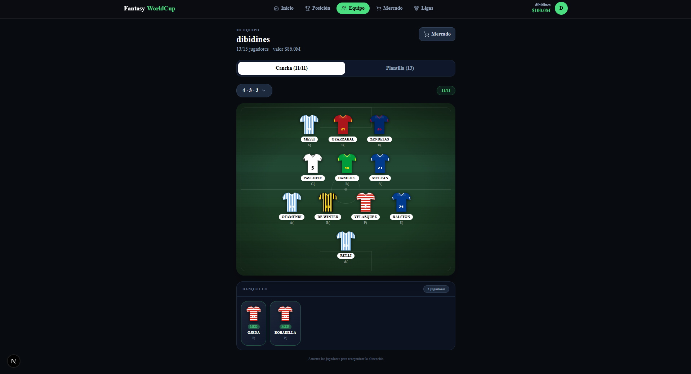

# Matías Di Benedetto Morales

**AI & Automation Developer.** I build WhatsApp AI agents, n8n workflows and applied-ML pipelines for real businesses, and I report what works *and* what doesn't.

📍 México · 📧 [matiasdibe23@gmail.com](mailto:matiasdibe23@gmail.com) · 🌐 [Portfolio](https://aidib-portfolio.vercel.app/) · 📄 [ML paper](https://aidib-portfolio.vercel.app/paper/) · 💻 [GitHub](https://github.com/matiasdibe23-sys)

---

## Featured projects

### 1. Content Decay Forecasting (applied ML)
Which pages will lose clicks next? A time-forward test on six months of real, pseudonymized Search Console data from my FlyRank ML internship.

- **Random Forest ROC-AUC 0.704 vs 0.633** for a one-line click-momentum rule on 19 seen clients (+0.071, 95% client-bootstrap interval +0.015 to +0.092).
- **Inconclusive on 6 unseen clients** (0.714 vs 0.702), reported as such.
- **My first model scored 1.0000 because the label was a SQL rule over its own features.** I audited it, then rebuilt the pipeline with leak controls (shuffled-label 0.506, deliberate-leak control 0.704 → 0.946).
- **Ranked review queue with validated reason codes.** Two of five codes failed validation and were dropped.

**Stack:** Python · DuckDB · pandas · scikit-learn  
**Links:** [Code and write-up in this repo](./ml-content-decay) · [Original repo](https://github.com/matiasdibe23-sys/Flyrank-Starter-Notebooks) · [Paper](https://aidib-portfolio.vercel.app/paper/)

---

### 2. WhatsApp booking agents with n8n + AI
Customers write in natural language; the agent books, modifies and cancels appointments, checks availability and hands off to a human when needed. Built for two small-business clients (a wellness center and a car wash). Exports are in [`/n8n-portfolio`](./n8n-portfolio) with all client data removed.

A separate ingestion workflow keeps the knowledge base current: Google Drive trigger → text splitter → OpenAI embeddings → Pinecone.

| System | What it does |
|---|---|
| [01 Wellness center](./n8n-portfolio/01-Masajes) | Booking agent with 11 workflows, human handoff and absence handling |
| [02 Car wash](./n8n-portfolio/02-Lavadero) | Same architecture adapted to slot-based car-wash appointments |
| [03 Lead generation](./n8n-portfolio/03-Lead-Generation) | Scrape → AI qualification → personalized message → send sequence |
| [04 Advanced chatbot](./n8n-portfolio/04-Advanced%20Chatbot) | Orchestrator + Supabase, appointment reminders, post-service follow-up, reactivation campaign |
| [05 Personal expenses](./n8n-portfolio/05-Gastos-Personales) | Telegram agent that logs and categorizes expenses into a sheet |

**Stack:** n8n · OpenAI · Evolution API (WhatsApp) · Pinecone · Supabase · Postgres · Google Calendar/Sheets · Telegram

---

### 3. Fantasy WorldCup 2026 (full-stack)
Fantasy football app for the 2026 World Cup: 15-player squads from 48 national teams, a $100M budget, private leagues and a matchday admin panel.

| Dashboard | Squad pitch |
|---|---|
|  |  |

- **Purchases run in a single Postgres RPC** (`fichar_jugador`) that takes a row lock (`FOR UPDATE`) and validates budget, squad composition and the per-nation limit atomically.
- **The 11-starter limit is enforced by a database trigger,** not only in the app.
- **Row Level Security** on user tables; admin writes use a server-side service-role client after `getUser()` verification.
- **17 ordered SQL migrations**, a scoring engine and per-matchday dynamic pricing with a price floor.

**Stack:** Next.js 16 · TypeScript · Supabase (Postgres, Auth, RLS, Realtime) · Tailwind CSS v4  
**Code:** [`/fantasy-worldcup-2026`](./fantasy-worldcup-2026)

---

### 4. Websites for local businesses
Seven responsive, SEO-optimized landing pages with WhatsApp integration and entrance animations.

| Site | Business |
|---|---|
| [Hero Boxing Club](https://matiasdibe23-sys.github.io/Web-dev/hero-boxing-club.html) | Boxing academy |
| [Hotel Casa Lucía](https://matiasdibe23-sys.github.io/Web-dev/hotel-casa-lucia.html) | Historic boutique hotel |
| [Kleur Salón](https://matiasdibe23-sys.github.io/Web-dev/kleur-salon.html) | Premium beauty salon |
| [Spa Relax Soul](https://matiasdibe23-sys.github.io/Web-dev/spa-relax-soul.html) | Holistic wellness center |
| [Tecny Fitness Center](https://matiasdibe23-sys.github.io/Web-dev/tecny-fitness-center.html) | Gym equipment sales and repair |
| [Veterinaria Happy Dog](https://matiasdibe23-sys.github.io/Web-dev/veterinaria-happy-dog.html) | Veterinary clinic |
| [Vida Fitness](https://matiasdibe23-sys.github.io/Web-dev/vidafitness.html) | Gym with 15+ disciplines |

**Stack:** HTML5 · CSS3 · JavaScript · Intersection Observer API · [screenshots and notes](./Web-dev)

---

## Stack

## About

B.Eng. in Information Technologies and Digital Business, Universidad Anáhuac Querétaro. Freelance AI developer. ML internship at [FlyRank](https://flyrank.ai).

> Client projects are shown with names, phone numbers, calendar and sheet IDs and endpoints removed. Replace every `YOUR_*` placeholder before importing a workflow into n8n.
